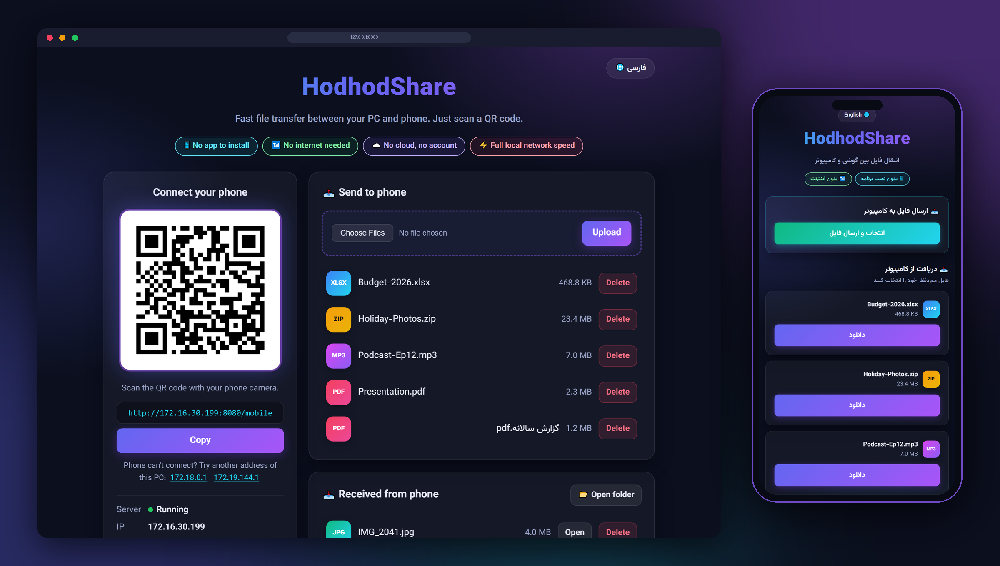
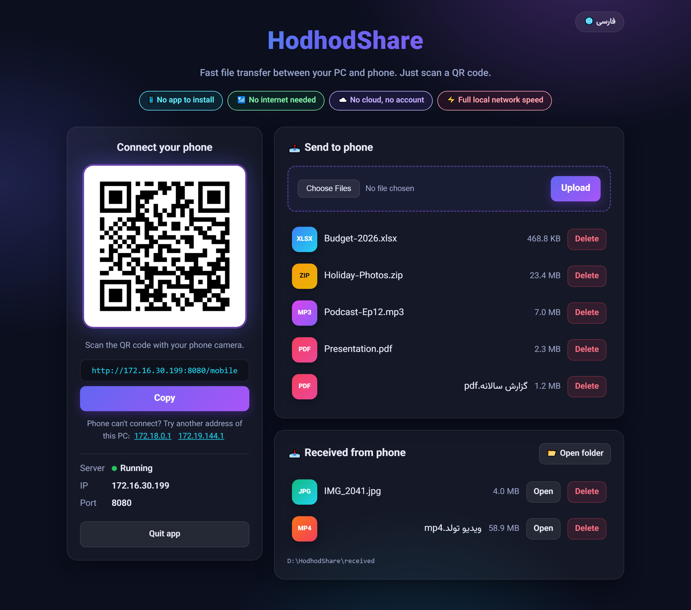
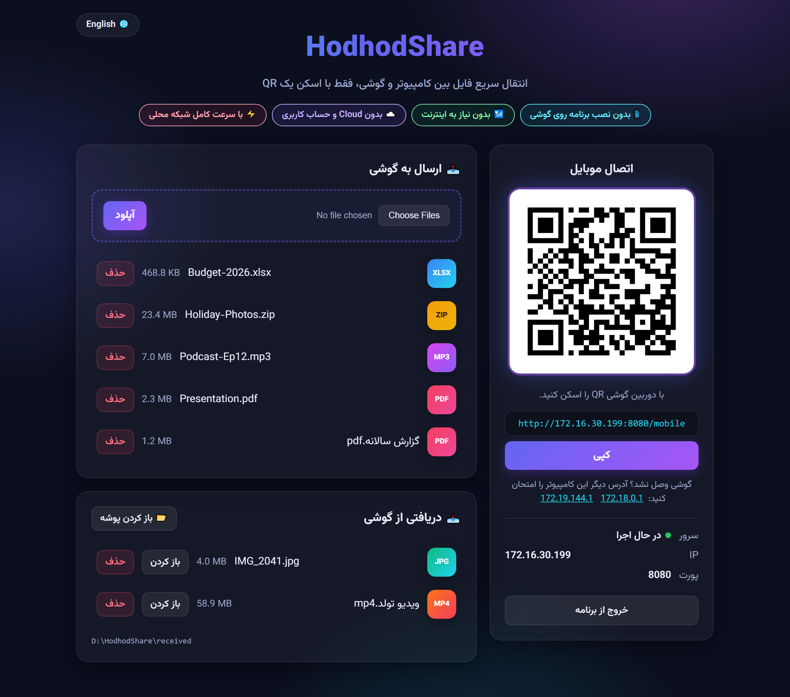
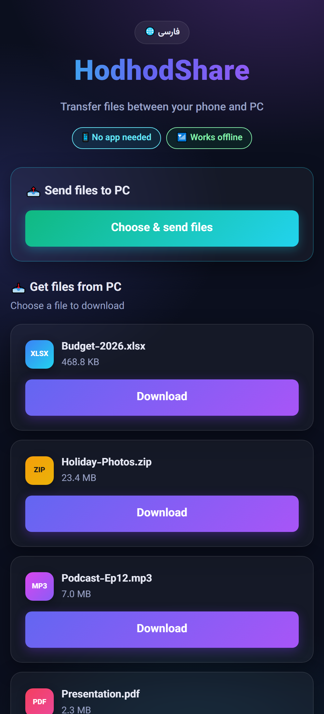
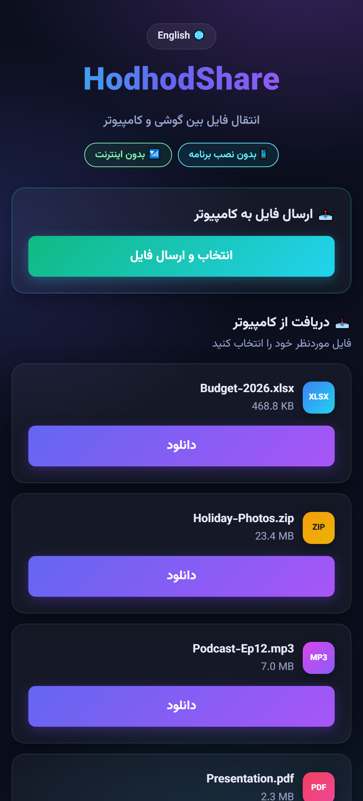

<div align="center">


# HodhodShare

**Share files between your Windows PC and your phone over local Wi‑Fi.**<br>
No app to install on the phone. No internet. No cloud. Just scan a QR code.

**انتقال فایل بین کامپیوتر و گوشی در شبکه محلی، فقط با اسکن یک QR**

[](https://github.com/erfanmohammadi1998/HodhodShare/releases/latest/download/HodhodShare.exe)


[English](#english) · [فارسی](#فارسی)

<br>



</div>

---

## English

### What is it?

HodhodShare is a tiny local file-sharing app. You run one `.exe` on your Windows PC, it shows a QR code, you scan it with your phone, and the phone's browser opens a page where you can **download files from the PC** and **send files to the PC**. All traffic stays on your local network.

The name comes from *Hodhod* (هدهد), the hoopoe: the messenger bird of Persian literature that carries a message straight to its destination.

### Features

- 🔁 **Two-way transfer**: PC → phone and phone → PC
- 📱 **Nothing to install on the phone**: works in any mobile browser (Android or iPhone)
- 📶 **No internet needed**: only a shared Wi‑Fi/LAN, even a router with no internet or a phone hotspot
- ☁️ **No cloud, no account, no database**: files go directly between the two devices
- 💻 **Single portable `.exe`**: no Python, no installer; runs in the background with no console window
- 🌐 **English and Persian (فارسی)** UI with full RTL support and a bundled Vazirmatn font (works offline)
- 📊 **Upload progress bar** on the phone, which is handy for large videos
- 🔄 **Live updates**: files sent from the phone appear on the PC page automatically
- 🧭 **Smart IP detection**: prefers your real Wi‑Fi/Ethernet adapter over VPN, WSL and Hyper‑V adapters
- 🔒 **Safe by default**: path-traversal protection, safe file names, PC-only admin page, and sandboxed preview of received files

### Screenshots

| PC: English | PC: فارسی |
|---|---|
|  |  |

| Phone: English | Phone: فارسی |
|---|---|
|  |  |

### Quick start

1. **Download** [`HodhodShare.exe`](https://github.com/erfanmohammadi1998/HodhodShare/releases/latest/download/HodhodShare.exe) from the [Releases](https://github.com/erfanmohammadi1998/HodhodShare/releases) page.
2. Put it in its own folder (it creates `shared/` and `received/` next to itself) and **double-click** it.
3. Your browser opens the HodhodShare page with a **QR code**.
4. Connect your phone to the **same Wi‑Fi** and **scan the QR code** with the camera.

> **Windows SmartScreen**: the exe is not code-signed, so Windows may show *"Windows protected your PC"*. Click **More info → Run anyway**.
>
> **Windows Firewall**: if asked, allow access on **Private networks** only.

### How to use

| I want to… | Do this |
|---|---|
| Send a file **to the phone** | On the PC page, choose files and click **Upload**, or copy them into the `shared/` folder. On the phone, tap **Download**. |
| Send a file **to the PC** | On the phone, tap **Choose & send files**. Files are saved to `received/` and show up on the PC page within seconds. |
| Switch language | Click **🌐 English / فارسی** at the top of the page. |
| Quit the app | Click **Quit app** on the PC page. Double-clicking the exe again just reopens the page if it's already running. |

### Run from source

```bat
git clone https://github.com/erfanmohammadi1998/HodhodShare.git
cd HodhodShare
python -m venv venv
venv\Scripts\activate
pip install -r requirements.txt
python app.py
```

Or simply double-click **`run.bat`**: it uses `venv` if present, installs missing dependencies, and starts the app.

### Build the exe

Double-click **`build.bat`**. It installs PyInstaller into `venv` and produces `dist\HodhodShare.exe`, a single file with the pages, icon and font bundled.

### How it works

```text
+------------ Windows PC ------------+               +---------- Phone -----------+
| HodhodShare.exe                    |               | Phone browser              |
|   Flask server on 0.0.0.0:8080     | <-- Wi-Fi --> | http://<PC-IP>:8080/mobile |
|   shared/   -> phone downloads     |     (LAN)     |                            |
|   received/ <- phone uploads       |               |                            |
+------------------------------------+               +----------------------------+
```

1. A local Flask web server starts on port **8080** (or the next free port).
2. The app finds the PC's local IP. On Windows it asks the OS which adapter is physical, so VPN and virtual adapters don't win.
3. It builds `http://<IP>:<port>/mobile` and renders it as a QR code.
4. The phone opens that page over plain HTTP on your LAN. Nothing leaves the network.

### Security notes

- Only files inside `shared/` can be downloaded, and phone uploads only land in `received/`. Path traversal (`../`, `..\`, encoded variants) is blocked.
- Uploaded file names are sanitized (paths and illegal characters removed, Persian names preserved) and never overwrite existing files.
- The PC page (upload, delete, received files, quit) only works from the PC itself. Other devices can only use `/mobile`.
- Received files open in a sandbox, so a malicious HTML/SVG can't run scripts.
- There is **no password**: anyone on the same network who knows the address can download from `shared/` and send files. Use it on networks you trust, and quit the app when you're done.

### Troubleshooting

- **Phone can't open the page**: make sure both devices are on the same Wi‑Fi (not mobile data), the Windows network profile is **Private**, and the firewall allows HodhodShare on private networks.
- **Wrong IP in the QR**: under the QR, click one of the other addresses listed for this PC. If a VPN is on, try turning it off.
- **Port 8080 is busy**: the app automatically uses the next free port (8081, 8082, …).

### Project structure

```
HodhodShare/
├── app.py              Flask server: IP detection, QR code, file handling
├── translations.py     English / Persian UI strings
├── requirements.txt    Flask, qrcode, Pillow
├── run.bat             Run from source on Windows
├── build.bat           Build the single-file HodhodShare.exe
├── templates/          base, desktop, mobile and "closed" pages
├── static/
│   ├── style.css
│   ├── favicon.ico     App icon
│   └── fonts/          Vazirmatn (SIL Open Font License)
├── shared/             Files on the PC for the phone
└── received/           Files received from the phone (created automatically)
```

### Credits

- Font: [Vazirmatn](https://github.com/rastikerdar/vazirmatn) by Saber Rastikerdar, licensed under the SIL Open Font License 1.1 (`static/fonts/OFL.txt`).
- Built with [Flask](https://flask.palletsprojects.com/), [qrcode](https://github.com/lincolnloop/python-qrcode) and [Pillow](https://python-pillow.org/).

Made by **[Erfan Mohammadi](https://erfanmohammadi.ir/)**.

---

<div dir="rtl">

## فارسی

### HodhodShare چیست؟

HodhodShare یک برنامه کوچک برای انتقال فایل در شبکه محلی است. یک فایل `exe` را روی کامپیوتر Windows اجرا می‌کنید، یک QR نمایش داده می‌شود، آن را با گوشی اسکن می‌کنید و در مرورگر گوشی صفحه‌ای باز می‌شود که می‌توانید **فایل را از کامپیوتر دانلود کنید** یا **فایل به کامپیوتر بفرستید**. همه‌چیز داخل شبکه محلی شما می‌ماند.

نام برنامه از **هدهد** گرفته شده؛ پرنده پیام‌رسان ادبیات فارسی که پیام را مستقیم به مقصد می‌رساند.

### ویژگی‌ها

- 🔁 **انتقال دوطرفه:** کامپیوتر به گوشی و گوشی به کامپیوتر
- 📱 **بدون نصب برنامه روی گوشی:** در مرورگر هر گوشی (Android یا iPhone) کار می‌کند
- 📶 **بدون نیاز به اینترنت:** فقط یک Wi‑Fi یا LAN مشترک لازم است، حتی مودم بدون اینترنت یا Hotspot گوشی
- ☁️ **بدون Cloud، حساب کاربری و دیتابیس:** فایل‌ها مستقیم بین دو دستگاه منتقل می‌شوند
- 💻 **تک‌فایلی:** فقط `HodhodShare.exe`؛ بدون نصب Python و بدون پنجره کنسول
- 🌐 **دوزبانه فارسی و English** با پشتیبانی کامل راست‌به‌چپ و فونت وزیرمتن (بدون اینترنت)
- 📊 **نوار پیشرفت ارسال** روی گوشی، مناسب ویدیوهای بزرگ
- 🔄 **به‌روزرسانی خودکار:** فایل‌های ارسالی از گوشی چند ثانیه بعد در صفحه کامپیوتر ظاهر می‌شوند
- 🧭 **تشخیص هوشمند IP:** کارت شبکه واقعی (Wi‑Fi/Ethernet) به کارت‌های مجازی VPN، WSL و Hyper‑V ترجیح داده می‌شود
- 🔒 **امن به‌صورت پیش‌فرض:** جلوگیری از Path Traversal، نام فایل امن، صفحه مدیریت فقط روی خود کامپیوتر

### شروع سریع

1. فایل [`HodhodShare.exe`](https://github.com/erfanmohammadi1998/HodhodShare/releases/latest/download/HodhodShare.exe) را از بخش [Releases](https://github.com/erfanmohammadi1998/HodhodShare/releases) دانلود کنید.
2. آن را داخل یک پوشه جداگانه بگذارید (پوشه‌های `shared` و `received` کنار آن ساخته می‌شوند) و روی آن **دابل‌کلیک** کنید.
3. صفحه HodhodShare با یک **QR** در مرورگر باز می‌شود.
4. گوشی را به **همان Wi‑Fi** وصل کنید و QR را با دوربین **اسکن** کنید.

> **پیام Windows protected your PC:** چون فایل امضای دیجیتال ندارد، روی **More info** و بعد **Run anyway** بزنید.
>
> **Windows Firewall:** اگر اجازه خواست، فقط برای **Private networks** اجازه دهید.

### نحوه استفاده

| می‌خواهم… | کار لازم |
|---|---|
| فایل **به گوشی** بفرستم | در صفحه کامپیوتر فایل را انتخاب و **آپلود** کنید (یا داخل پوشه `shared` کپی کنید). روی گوشی **دانلود** را بزنید. |
| فایل **به کامپیوتر** بفرستم | روی گوشی **انتخاب و ارسال فایل** را بزنید. فایل در پوشه `received` ذخیره می‌شود و در صفحه کامپیوتر نمایش داده می‌شود. |
| زبان را عوض کنم | دکمه **🌐 English / فارسی** بالای صفحه را بزنید. |
| برنامه را ببندم | در صفحه کامپیوتر **خروج از برنامه** را بزنید. اگر برنامه باز باشد و دوباره روی exe دابل‌کلیک کنید، فقط صفحه آن باز می‌شود. |

### اجرا از سورس

```bat
git clone https://github.com/erfanmohammadi1998/HodhodShare.git
cd HodhodShare
python -m venv venv
venv\Scripts\activate
pip install -r requirements.txt
python app.py
```

یا روی **`run.bat`** دابل‌کلیک کنید. برای ساخت فایل exe هم **`build.bat`** را اجرا کنید؛ خروجی در `dist\HodhodShare.exe` ساخته می‌شود.

### نکات امنیتی

- فقط فایل‌های داخل `shared` قابل دانلود هستند و فایل‌های گوشی فقط در `received` ذخیره می‌شوند. Path Traversal مسدود است.
- نام فایل‌ها پاک‌سازی می‌شود (نام فارسی حفظ می‌شود) و هیچ فایلی بازنویسی نمی‌شود.
- صفحه مدیریت (آپلود، حذف، فایل‌های دریافتی، خروج) فقط روی خود کامپیوتر کار می‌کند.
- **رمز عبور وجود ندارد:** هر کسی در همان شبکه که آدرس را بداند می‌تواند از `shared` دانلود کند و فایل بفرستد. فقط در شبکه‌های مورد اعتماد استفاده کنید و بعد از کار برنامه را ببندید.

### رفع مشکل

- **گوشی صفحه را باز نمی‌کند:** هر دو دستگاه باید روی یک Wi‑Fi باشند (نه اینترنت موبایل). پروفایل شبکه Windows باید **Private** باشد و Firewall اجازه داده باشد.
- **IP داخل QR اشتباه است:** زیر QR روی یکی از آدرس‌های دیگر این کامپیوتر کلیک کنید. اگر VPN روشن است، آن را خاموش کنید.
- **پورت 8080 اشغال است:** برنامه خودش از پورت آزاد بعدی (8081، 8082، …) استفاده می‌کند.

ساخته‌شده توسط **[عرفان محمدی](https://erfanmohammadi.ir/fa/)**

</div>
